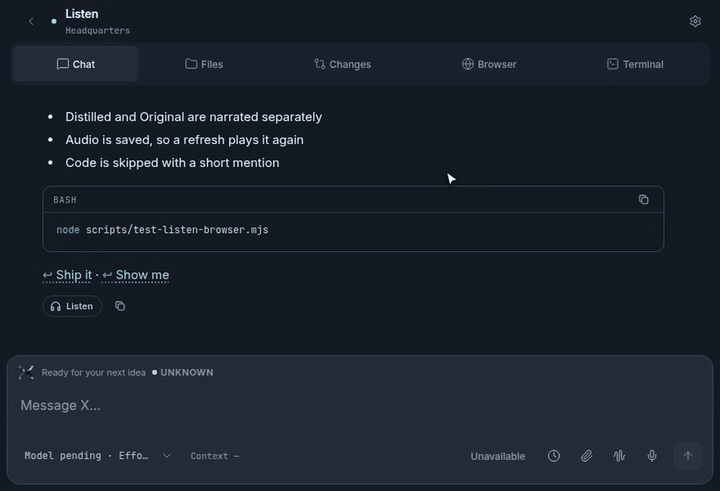
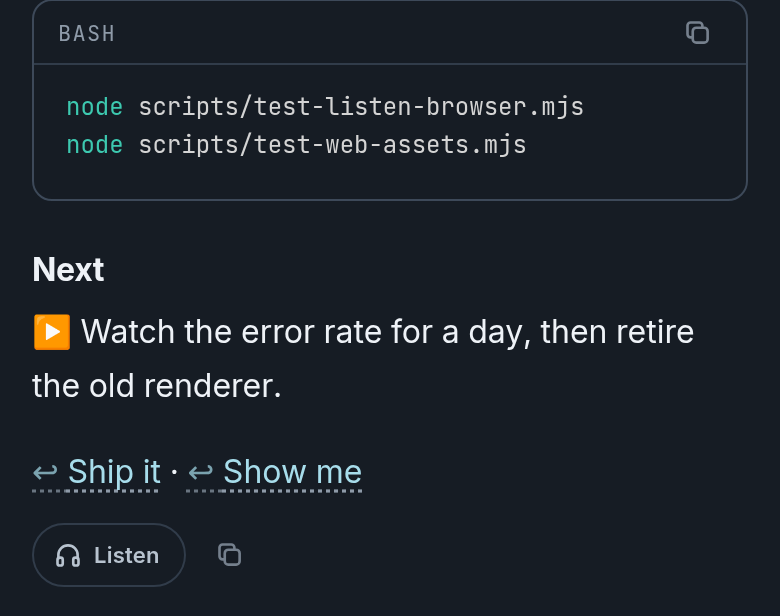
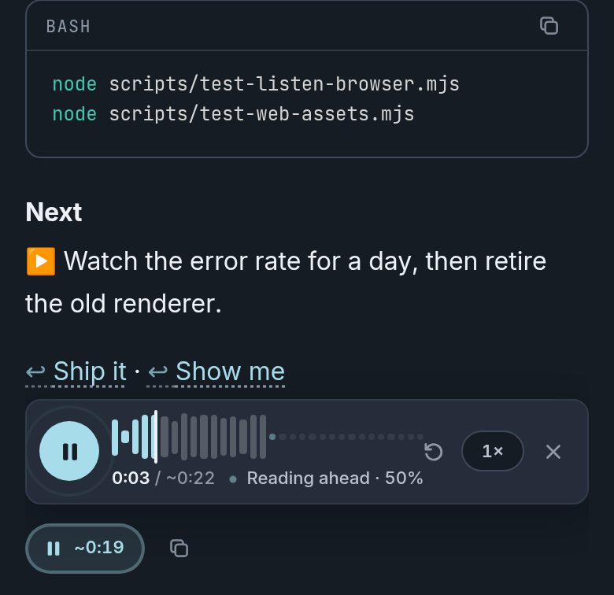
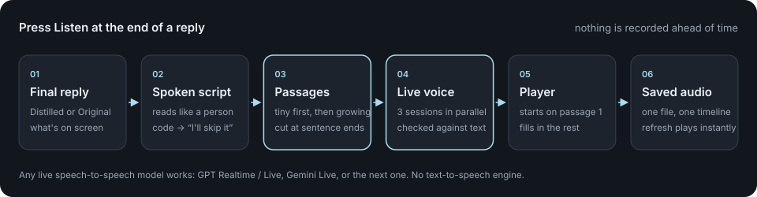
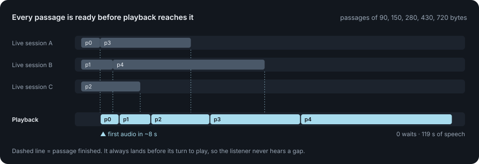

# X Audio

**Listen to your agent's final reply, read like a person would read it to you.**

At the end of every final reply there's a **Listen** button. Press it, and a live voice agent reads the reply aloud. Audio starts within seconds and fills in while you listen. Code isn't read out character by character: the voice mentions it and moves on.

<video src="https://raw.githubusercontent.com/pisakhov/x-audio/demo-video/assets/demo.mp4" controls width="720"></video>

 Press Listen → <i>Preparing</i> → playing while it reads ahead → saved. <a href="assets/demo.mp4">Watch with sound (29 s)</a>

<table>
  <tr>
    <td></td>
    <td></td>
  </tr>
  <tr>
    <td align="center">At the end of the reply, where reading ends</td>
    <td align="center">Already playing, still reading ahead</td>
  </tr>
</table>

## Principles

1. **The button sits at the end of the reply.** Listen and Copy come after the last line, where a long read finishes. Nobody has to scroll back up to use them.
2. **A live voice agent, not text-to-speech.** The voice comes from a live speech-to-speech model told to read the text verbatim. TTS still sounds robotic, and a live voice sounds like a person talking to you. Any live model works.
3. **Read it like a human would.** A deterministic script writer, with no LLM, turns the markdown into speech before any audio is made. Code, diagrams and artifacts are announced, then skipped.
4. **On demand only.** Nothing is pre-recorded. Audio exists only after someone presses Listen.
5. **The version on screen.** If the reply has a short (distilled) and a full (original) version, the one being viewed is read. Each version gets its own audio.
6. **Start now, fill in the rest.** The reply is split into passages: a tiny first passage, then larger ones. Several live sessions read them in parallel. Playback starts on the first passage and never waits for the rest.
7. **Saved once.** The audio is cached by text, voice and version, so a refresh plays it instantly, and edited text gets new audio.

## Read like a person

The real output of the script writer for one reply:

| On screen | Heard |
| --- | --- |
| `## ✅ Release shipped` | "Release shipped." *(longer pause)* |
| `1. Run the unit tests` `2. Check the phone layout` | "First, run the unit tests. Second, check the phone layout." |
| a fenced `bash` block | "There's a few shell commands here, which I'll skip." |
| `⚠️ The old renderer is still on for a day.` | "Heads up: The old renderer is still on for a day." |
| `[the rollout guide](https://…)` or `` `src/player/strip.ts` `` | "the rollout guide" · "strip.ts" |
| a small table | "Here is a quick table. First paint: Before 1.8 s, After 0.6 s. …" |
| a diagram or large table | "Next comes a diagram. I'll skip over it." |
| `[Ship it](reply:) · [Show me](reply:)` | "Suggested replies. First: Ship it. Second: Show me." |

## Never wait for the voice

A live voice speaks at about real time, so each passage has to finish rendering before playback reaches it. The rule:

- The first passage is at most about 90 bytes, cut at a clause if needed.
- After that, every passage is cut at a sentence end and kept no longer than the audio already queued ahead of it.

See [ARCHITECTURE.md](ARCHITECTURE.md) for the pacing rule, the segment timeline, the player and storage.

## Bring your own stack

This is a set of design decisions, not a library. Swap any part:

| Part | What we use | Also works |
| --- | --- | --- |
| Live voice | GPT Live (OpenAI) | Gemini Live, any realtime speech-to-speech model |
| Agent runtime | our coding agent | Google ADK, LangGraph, your own loop |
| Audio | AAC `.m4a`, served with HTTP Range requests | Opus/WebM, MP3 |
| Player | a small web player in the chat | a native app, a CLI |

## License

[MIT](LICENSE)
